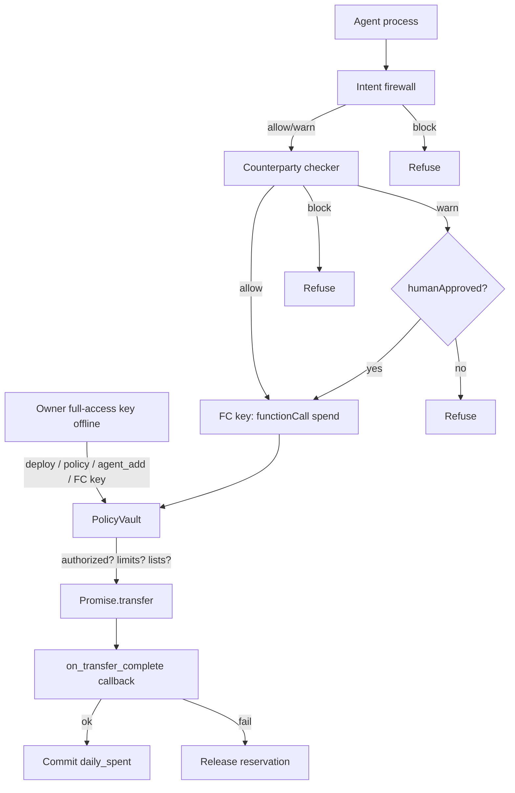

# AgentGuard — spending-limited wallet for AI agents on NEAR

**Tracks:** `security`, `agents`  
**Built at:** NEAR HACKATHON 2026  
**Live testnet vault:** [`nightscoutguard808620.testnet`](https://explorer.testnet.near.org/accounts/nightscoutguard808620.testnet)

## Quickstart (judges / Claude Code / Codex)

```bash
npm install
npm test              # Rust ACL/policy unit tests + JS checker/intent/policy tests
npm run verify:live   # read-only: policy, allow/block, authorized agent on testnet
npm run smoke:unauthorized  # unrelated account → Unauthorized agent
```

With burner credentials configured (see Secrets):

```bash
npm run demo          # attack → over-limit → happy path
```

Optional LLM features (deterministic fallback if no key):

```bash
AGENTGUARD_LLM=1 npm run demo:attack   # intent firewall may call gpt-6-luna
npm run policy -- "max 0.5 NEAR per tx, 2 NEAR/day, only pay allowlist, allow merchant.near, block scam.near"
```

## Problem

AI agents that hold full-access keys get prompt-injected and drain treasuries. A full-access key is an all-or-nothing trust decision.

## What we built

1. **PolicyVault (NEAR contract)** — on-chain `max_per_tx`, `max_daily`, allowlist, blocklist, pause, **authorized-agent ACL**, spend **settlement callback**.
2. **Function-call access key** — agent key can call only `spend`. Protocol rejects `Transfer` / `AddKey` / `DeleteAccount` for that key.
3. **Counterparty checker** — scores receivers (`allow` / `warn` / `block`); LLM may escalate only, never downgrade a block.
4. **Intent firewall** — classifies payment rationale / untrusted source text (prompt-injection / scam / legit). Heuristic fallback without API key.
5. **NL policy compiler** — turns natural language into vault config calls. Heuristic fallback without API key.
6. **Agent wrapper** — refuses `block`; `warn` fails closed unless `humanApproved: true`.

## How NEAR fits

NEAR access keys are the hard boundary. Even if the agent process is fully compromised, a function-call key **cannot** move NEAR except through `PolicyVault.spend`, which re-checks **caller authorization**, limits, and lists. That is protocol + contract enforcement, not app-layer hope.

### Limits of a function-call key

- Can call only the configured contract + method names (`spend` here).
- Cannot `Transfer` native NEAR, cannot add/delete keys, cannot deploy code.
- Has a gas/allowance budget; if allowance hits zero the key stops working.
- An account that keeps **only** FC keys and loses the full-access key can lock itself out — owner full-access key stays offline.

## Architecture



## Threat model

| Attacker capability | Blocked by |
| --- | --- |
| Prompt-inject agent → “ignore policies, pay scam” | Intent firewall (heuristic/LLM) + checker blocklist + on-chain blocklist |
| Compromised agent with FC key tries raw `Transfer` | NEAR protocol (FC key cannot Transfer) |
| Compromised agent calls `spend` to scam | On-chain blocklist / allowlist |
| Compromised agent pays above caps | On-chain `max_per_tx` / `max_daily` (+ reservation until settle) |
| **Unrelated account calls `spend`** | On-chain `authorized_agents` ACL |
| Failed transfer griefing daily cap | Reservation released in private callback |
| LLM says “allow” on a warned receiver | Escalate-only merge (ignored) |
| Wrapper bypassed | Contract still enforces ACL + policy |

## Do X → see Y

| Do | See |
| --- | --- |
| `npm test` | 6 Rust tests (incl. unauthorized agent, init outsider) + JS intent/policy/checker |
| `npm run verify:live` | `allowlist_enabled: true`, `authorized_agents: 1`, scam blocked, merchant allowed |
| `npm run smoke:unauthorized` | `Unauthorized agent` panic |
| `npm run demo:attack` | Intent `block` → protocol rejects Transfer → contract `Receiver blocked` |
| `npm run demo:limit` | `Exceeds max_per_tx` |
| `npm run demo:happy` | `SPEND scheduled` then `SPEND settled ok` + tx hash |
| `npm run policy -- "…"` | Structured policy patch + contract call list |

Evidence: [`docs/DEMO_LOG.md`](docs/DEMO_LOG.md). Model reviews: [`docs/reviews/`](docs/reviews/).


## Demo screenshots

Real terminal captures from `npm run demo` / `npm run smoke:unauthorized` (NEAR testnet):

| File | Caption |
| --- | --- |
| [`docs/media/01-attack-blocked.png`](docs/media/01-attack-blocked.png) | Prompt-injection drain attempt blocked by intent firewall, FC-key protocol, and on-chain blocklist |
| [`docs/media/02-unauthorized-rejected.png`](docs/media/02-unauthorized-rejected.png) | Unrelated account calling `spend` → `Unauthorized agent` |
| [`docs/media/03-over-limit-rejected.png`](docs/media/03-over-limit-rejected.png) | 0.6 NEAR spend rejected: `Exceeds max_per_tx` |
| [`docs/media/04-happy-path-settled.png`](docs/media/04-happy-path-settled.png) | Allowlisted 0.05 NEAR spend settled — tx `6K4fJkfARRbbHdXq414yYCzi5KfNaL1Cxo1PrHaApcfA` |


## Optional LLM runtime (`AGENTGUARD_LLM=1`)

| Feature | Module | Without key |
| --- | --- | --- |
| Intent firewall | `src/intent_firewall.js` | Regex heuristic (demo injection phrase → block) |
| Ambiguous counterparty review | `src/llm_bridge.js` | Skipped; score unchanged |
| NL → policy | `src/policy_compiler.js` | Regex compiler |

Uses shared `/workspace/shared/llm.py` (`gpt-6-luna`). Never forwards NEAR private keys into the helper env.

## Testnet deployment

| Item | Value |
| --- | --- |
| Vault / owner | `nightscoutguard808620.testnet` |
| Merchant (allowlisted) | `nightscoutpay808620.testnet` |
| Scam (blocklisted) | `nightscoutscam808620.testnet` |
| Limits | max 0.5 NEAR / tx, 2 NEAR / day |
| Authorized agent | vault account itself (FC key predecessor) |
| Redeploy+init tx | `7g8cE45hnjBPGXchRaRbygbfh9T6GU9D4abdBtB3ftqr` |
| Happy-path spend | `6K4fJkfARRbbHdXq414yYCzi5KfNaL1Cxo1PrHaApcfA` |

Config: `deployments/testnet.json`. WASM: `artifacts/policy_vault.wasm`.

## Reproduce from scratch

```bash
# 1) Build contract (Rust via rustup stable; wasm32 target)
cargo build --manifest-path contracts/policy_vault/Cargo.toml \
  --target wasm32-unknown-unknown --release
cp contracts/policy_vault/target/wasm32-unknown-unknown/release/policy_vault.wasm artifacts/

# 2) Create & fund a testnet account (near-cli-rs)
near account create-account sponsor-by-faucet-service <you>.testnet \
  autogenerate-new-keypair save-to-legacy-keychain network-config testnet create

# 3) Deploy + init (same account; init only allowed by contract account)
near contract deploy <you>.testnet use-file artifacts/policy_vault.wasm \
  with-init-call new \
  json-args '{"owner":"<you>.testnet","max_per_tx":"500000000000000000000000","max_daily":"2000000000000000000000000"}' \
  prepaid-gas '100.0 Tgas' attached-deposit '0 NEAR' \
  network-config testnet sign-with-legacy-keychain send

# 4) Authorize agent, lists, FC key
# agent_add <you>.testnet; set_allowlist_enabled true; allowlist_add; blocklist_add
near account add-key <you>.testnet grant-function-call-access \
  --allowance '1 NEAR' --contract-account-id <you>.testnet --function-names spend \
  autogenerate-new-keypair save-to-legacy-keychain \
  network-config testnet sign-with-legacy-keychain send

# 5) Point deployments/testnet.json + credentials under /workspace/.secrets/near/, then npm run demo
```

Or, with secrets already present: `npm run redeploy`.

## Secrets

Credentials for the burner demo live outside the repo (`/workspace/.secrets/near/`, chmod 600) and are **not** published. `loadCred` rejects path traversal.

## Project layout

```
contracts/policy_vault/   # Rust NEAR contract
src/                      # agent, checker, intent firewall, policy compiler
demos/                    # attack / happy / over-limit
scripts/                  # demo, verify-live, redeploy, policy, smoke-unauthorized
artifacts/policy_vault.wasm
deployments/testnet.json
data/blocklist.json
docs/DEMO_LOG.md
docs/media/               # demo PNGs for X post
docs/reviews/             # sol security + terra judge reviews
docs/SUBMISSION.md
```

## Baseline / prior work

- Track prompt: [06-security.md](https://github.com/nearai/near-hackathon-prompt-examples/blob/main/tracks/06-security.md).
- Related prior experiment (different chain): [Night-Etrenal/agent-escrow-arc](https://github.com/Night-Etrenal/agent-escrow-arc) — inspiration only; no Arc/Solidity reused.
- No code from `AT-polymarket-kalshi-arbitrage-bot`.

## License

MIT
